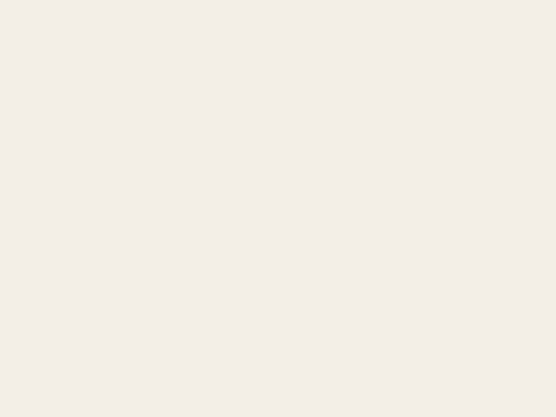

# motivators-board

[](https://www.npmjs.com/package/motivators-board)
[](https://github.com/asiermarques/motivators-board/actions/workflows/ci.yml)
[](https://nodejs.org)
[](LICENSE)

**A game-like board to talk about what motivates a person.** They rank every motivator card from least to most
important, mark which ones are met or unmet in their life right now, and keep or send the result as a link. No
accounts, no backend: you deploy it as a static site with your own motivators, texts and look.

<p align="center">
  
</p>

Inspired by [Moving Motivators](https://management30.com/practice/moving-motivators/) from Management 3.0. Use it in
one-to-ones, team retrospectives, onboarding or coaching sessions, in the room or on a video call.

## Contents

- [Features](#features)
- [How a session goes](#how-a-session-goes)
- [Quick start](#quick-start)
- [Deploy](#deploy)
- [Configuration](#configuration)
- [The share link](#the-share-link)
- [Public contract and versioning](#public-contract-and-versioning)
- [Developing motivators-board](#developing-motivators-board)

## Features

- **Rank by dragging**: move the cards with the mouse, touch or the keyboard. The order is strict, with no ties.
- **Met and unmet**: slide a card to the right (met) or to the left (unmet) to show whether it is fulfilled today.
- **Flip a card** to read its description.
- **A live summary** beside the board lists the three most and the three least motivating cards.
- **No backend**: the whole board lives in the URL fragment, so a link is a snapshot you can bookmark or send.
- **Yours to configure**: your own motivators, icons, colours, texts, logo, footer and theme, checked before every
  build.
- **Static output**: `npm run build` writes plain files with relative paths that you can deploy anywhere.
- **Accessible**: every move works from the keyboard and is announced to screen readers.

## How a session goes

1. Open the board. The cards are dealt in a random order, so the first order says nothing about the person.
2. Type the person's name.
3. Drag the cards until the order feels right: the most important on top, the least important at the bottom.
4. Slide each card sideways: to the right if that motivator is met today, to the left if it is not, in the centre if
   neither.
5. Click a card to flip it and read what it means.
6. Press **Copy link** and keep it, or send it. Opening the link brings back that exact board, so you can compare it
   with the next session.

| keyboard (on a focused card) | does                                     |
| ---------------------------- | ---------------------------------------- |
| <kbd>↑</kbd> / <kbd>↓</kbd>  | more / less important                    |
| <kbd>Home</kbd> / <kbd>End</kbd> | to the bottom / to the top           |
| <kbd>→</kbd> / <kbd>←</kbd>  | one place towards met / towards unmet    |
| <kbd>Enter</kbd>             | flip the card                            |

## Quick start

Create a repository for your board and install motivators-board in it:

```sh
npm init -y
npm install motivators-board
npx motivators-board init   # copies the sample configuration to config/ and adds the npm scripts
npm run dev                 # the board with your configuration; it reloads when config/ changes
```

When it looks right:

```sh
npm run check               # lists every problem of the configuration
npm run build               # static files in dist/, ready to deploy
npm run preview             # serves dist/ locally
```

`dev` and `preview` take `--host`, `--port` and `--open`, as Vite does. Requires Node.js 22.12 or newer.

## Deploy

`dist/` is a plain static site with relative paths: upload it to any static host, or to a subfolder of one.

On **Netlify**, copy [`netlify.toml`](netlify.toml) and [`.nvmrc`](.nvmrc) to the root of your repository and import
it. It builds with `npm run build`, publishes `dist/`, and caches the hashed files in `dist/assets/` forever.

## Configuration

Everything that makes the board yours lives in `config/`. Any file you do not add is read from the sample
configuration.

```
config/
├── settings.yml          # the title, the logo, the footer (Markdown) and the locale
├── motivators/
│   ├── autonomy.md       # one file per motivator: its icon, colour, title and description
│   └── …
├── i18n/
│   └── en.yml            # overrides of the UI strings
├── theme.css             # CSS loaded after the base styles
└── autonomy.svg, …       # the svg, png, jpg, jpeg, webp or gif files that the settings and motivators use
```

### `settings.yml`

It accepts only these keys:

```yaml
title: Motivators Board          # the header and the browser tab title
logo: logo.svg                   # optional, an image of the config folder
footer: |                        # optional, Markdown
  Made by [us](https://example.com)
locale: en                       # the Locale of the titles, descriptions and UI strings
```

### Motivators

A motivator file is named after its key (`[a-z0-9-]+`), which is what the share link uses:

```md
---
icon: autonomy.svg
colour: "#6b4fa0"
title: Autonomy
---

Freedom to make decisions about your work.
```

Once `config/motivators/` exists it is the whole set: the sample motivators are not added to it.

### UI strings

`i18n/<locale>.yml` overrides UI strings by their nested key, as named in [`src/strings.ts`](src/strings.ts). Only
`en` is shipped, so any other Locale must translate every string:

```yaml
share:
  copy: Copy the link
```

To read the configuration from another folder, set `MOTIVATORS_BOARD_CONFIG_DIR`. See
[`config/README.md`](config/README.md) for the details.

## The share link

```
#name=Ana&lang=en&met=craft&unmet=money&order=money,impact,craft,…
```

- `order` lists the motivator keys from least to most important.
- `met` and `unmet` list the motivators whose card sits to the right or to the left. Each one is left out when it is
  empty.

Old or hand-edited links always open. Unknown keys and duplicates are dropped, missing motivators are added at the
end, and a notice says what changed.

## Public contract and versioning

motivators-board follows [semver](https://semver.org) on its public contract. That contract is the commands and npm
script names, the configuration files described above, and the share link format. `src/` is not part of it. A change
to any of them that can break an Adopter repository is a major version. That includes several Locales per motivator
file.

## Developing motivators-board

Requires Node.js 22.12 or newer (see [`.nvmrc`](.nvmrc)).

```sh
npm install
npm run dev
npm test -- --run && npm run build
```

Before changing anything, read [`docs/PRODUCT.md`](docs/PRODUCT.md), [`docs/ARCHITECTURE.md`](docs/ARCHITECTURE.md),
[`docs/DESIGN.md`](docs/DESIGN.md) and the [ADRs](docs/adr/). Pushing a `vX.Y.Z` tag that matches `package.json`
publishes the package to npm.

## License

[MIT](LICENSE) © Asier Marqués. Made with ☕.

Moving Motivators is a practice of [Management 3.0](https://management30.com/). This project is not affiliated with
it.
